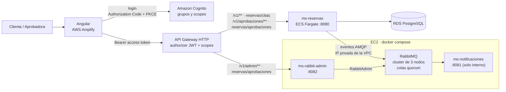
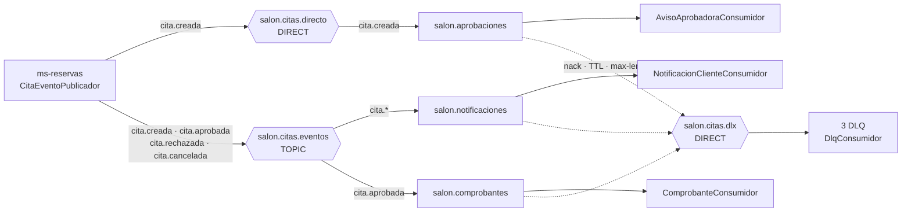

# Agenda Belleza · sistema de reservas cloud native

Sistema de reservas para un salón de belleza, al estilo AgendaPro. Proyecto de **DSY1107 Desarrollo Cloud Native I**.

Hay dos roles, que salen de los grupos de Amazon Cognito:

- **Clienta** (grupo `clientes`): reserva una hora eligiendo servicio, especialista y horario, y puede editar o cancelar sus citas mientras estén pendientes.
- **Aprobadora** (grupo `aprobadores`): revisa las citas pendientes y las aprueba o rechaza con un comentario. También administra el catálogo y RabbitMQ.

Cada cambio de una cita genera un **evento** que viaja por RabbitMQ hasta los consumidores: avisos a la clienta, aviso a la aprobadora y comprobante de reserva.

---

## Arquitectura



- **Infraestructura:** está toda en Terraform ([infra/](infra)) y se aplica a mano, con estado local.
- **Despliegue del código:** el backend se publica en ECS con un script o con GitHub Actions; el front, en Amplify; RabbitMQ y los dos microservicios de mensajería los levanta la EC2 con `docker compose`.

## Microservicios

| Microservicio | Carpeta | Puerto | Responsabilidad | Despliegue |
|---|---|---|---|---|
| **ms-reservas** | [raíz (`/`)](src/main/java/com/belleza/reservas) | 8080 | Citas (crear, editar, cancelar), aprobaciones, catálogo de servicios y especialistas. **Productor** de los eventos de citas. | ECS Fargate (imagen en ECR) con [scripts/publicar-ecs.ps1](scripts/publicar-ecs.ps1) o el pipeline *Back · Deploy* |
| **ms-notificaciones** | [ms-notificaciones/](ms-notificaciones) | 8081 | **Consumidores** de los eventos (aviso a la clienta, aviso a la aprobadora, comprobante), las DLQ y el ejemplo *Hello World* de la guía 2.1.2. | EC2, con `docker compose` |
| **ms-rabbit-admin** | [ms-rabbit-admin/](ms-rabbit-admin) | 8082 | API REST para administrar colas, exchanges y bindings en tiempo de ejecución, con `RabbitAdmin`. | EC2, con `docker compose`, detrás del API Gateway |
| **frontend** | [frontend/](frontend) | 4200 (local) | SPA Angular 22: login, *Mis citas* (clienta), *Pendientes* (aprobadora) e *Identidad* (demo de los tokens). | AWS Amplify, con el pipeline *Front · Deploy* |

Los tres microservicios usan Spring Boot 4.1.1 y Java 21, y cada uno es un proyecto Maven independiente con su propio `mvnw`.

---

## Mensajería con RabbitMQ

### Topología

| Exchange | Tipo | Routing key / patrón | Cola (quorum) | DLQ (quorum) | Consumidor |
|---|---|---|---|---|---|
| `salon.citas.eventos` | **TOPIC** | `cita.*` | `salon.notificaciones` | `salon.notificaciones.dlq` | [NotificacionClienteConsumidor](ms-notificaciones/src/main/java/com/belleza/notificaciones/notificacion/NotificacionClienteConsumidor.java) |
| `salon.citas.eventos` | **TOPIC** | `cita.aprobada` | `salon.comprobantes` | `salon.comprobantes.dlq` | [ComprobanteConsumidor](ms-notificaciones/src/main/java/com/belleza/notificaciones/comprobante/ComprobanteConsumidor.java) |
| `salon.citas.directo` | **DIRECT** | `cita.creada` | `salon.aprobaciones` | `salon.aprobaciones.dlq` | [AvisoAprobadoraConsumidor](ms-notificaciones/src/main/java/com/belleza/notificaciones/aprobacion/AvisoAprobadoraConsumidor.java) |
| `salon.citas.dlx` | **DIRECT** (dead letter) | `notificaciones` / `comprobantes` / `aprobaciones` | las 3 DLQ | — | [DlqConsumidor](ms-notificaciones/src/main/java/com/belleza/notificaciones/dlq/DlqConsumidor.java) |
| *(default)* | direct | `salon.saludos` | `salon.saludos` | — | [SaludoConsumidor](ms-notificaciones/src/main/java/com/belleza/notificaciones/saludo/SaludoConsumidor.java) (guía 2.1.2) |

- **Colas principales:** tienen `x-dead-letter-exchange`, `x-dead-letter-routing-key`, `x-message-ttl` (5 min) y `x-max-length` (1000).
- **DLQ:** guardan los mensajes 24 h (`x-message-ttl`).
- **Durabilidad:** todo es durable y quorum, es decir, replicado en los 3 nodos. Los mensajes se publican **persistentes**.

### Flujo de los eventos



| Evento | Cuándo | Llega a |
|---|---|---|
| `cita.creada` | la clienta reserva | `salon.aprobaciones` (por el DIRECT) y `salon.notificaciones` (por el TOPIC) |
| `cita.aprobada` | la aprobadora aprueba | `salon.notificaciones` y `salon.comprobantes` |
| `cita.rechazada` | la aprobadora rechaza, con comentario obligatorio | `salon.notificaciones` |
| `cita.cancelada` | la clienta cancela una cita pendiente | `salon.notificaciones` |

### Fiabilidad
- **La cita se guarda aunque RabbitMQ falle.** [CitaService](src/main/java/com/belleza/reservas/service/CitaService.java) solo publica un evento de Spring. [CitaEventoPublicador](src/main/java/com/belleza/reservas/mensajeria/CitaEventoPublicador.java) lo envía a RabbitMQ **después del commit** (`@TransactionalEventListener(AFTER_COMMIT)`). Si RabbitMQ no responde, registra `log.error` con `eventoId` y `citaId` y **no** propaga la excepción: la API responde bien y la cita ya está guardada.
- **Publisher confirms (broker → productor):** `publisher-confirm-type=correlated`, `publisher-returns=true` y `mandatory=true`. [ConfirmacionesRabbitConfig](src/main/java/com/belleza/reservas/mensajeria/ConfirmacionesRabbitConfig.java) registra el ack o nack del broker y los mensajes que no encontraron cola. Cada mensaje lleva `messageId = eventoId`.
- **ACK manual (consumidor → broker):** los consumidores de citas usan `AcknowledgeMode.MANUAL` y `prefetch 1`. Siempre responden `basicAck` o `basicNack`; nunca dejan un mensaje colgado.
- **Error transitorio o permanente:** [ConsumoConAck](ms-notificaciones/src/main/java/com/belleza/notificaciones/evento/ConsumoConAck.java) documenta la decisión en una tabla dentro del código.

  | Situación | Decisión |
  |---|---|
  | `ErrorTransitorio` (recuperable) | Reintenta con **backoff exponencial**: 1 s, 2 s y 4 s, hasta 3 reintentos. Si se agotan, `basicNack(tag, false, false)` y el mensaje va a la **DLQ**. |
  | `ErrorPermanente` o datos inválidos | `basicNack` inmediato y el mensaje va a la DLQ, sin reintentar. |
  | Error inesperado | Se trata como permanente. |
  | JSON que no se puede convertir | Spring AMQP lo rechaza sin reencolar y termina en la DLQ. |

- **DLQ y logs:** [DlqConsumidor](ms-notificaciones/src/main/java/com/belleza/notificaciones/dlq/DlqConsumidor.java) registra cada mensaje muerto con la cola de origen, `eventoId`, `citaId`, el motivo y la cantidad de veces que llegó a la DLQ (headers `x-death`), y le hace ACK.
- **Idempotencia:** la entrega es *at-least-once*, así que [RegistroEventosProcesados](ms-notificaciones/src/main/java/com/belleza/notificaciones/evento/RegistroEventosProcesados.java) guarda los `eventoId` ya procesados **por cola**. Si un evento llega repetido, se registra como "duplicado ignorado" y se confirma con ACK sin reprocesarlo.
- **Alta disponibilidad:** el cluster tiene 3 nodos ([rabbitmq/](rabbitmq)) y las colas son quorum. Un nodo puede caer sin perder mensajes: la cola elige un líder nuevo y los microservicios se reconectan a otro nodo (`spring.rabbitmq.addresses`). El procedimiento de failover está en [rabbitmq/README.md](rabbitmq/README.md).
- **Simulación de fallos para la demo:** si un mensaje trae el header `x-simular-fallo` con el valor `transitorio` o `permanente`, se fuerza ese error. Sin ese header, el procesamiento es normal.

---

## Seguridad

| Capa | Qué hace | Dónde |
|---|---|---|
| **Login** | Cognito Hosted UI con **Authorization Code + PKCE (S256)**, `state` y `nonce`. Es un cliente público, sin secreto. | [auth.service.ts](frontend/src/app/auth/auth.service.ts), [cognito.tf](infra/cognito.tf) |
| **Scopes de la API** | El *resource server* `reservas` publica `reservas/citas` y `reservas/aprobaciones`. | [cognito.tf](infra/cognito.tf#L80) |
| **API Gateway** | Un authorizer JWT valida firma, issuer, audiencia y vigencia, y exige un **scope por ruta**: `reservas/citas` en `/v1/**` y `reservas/aprobaciones` en `/v1/aprobaciones/**` y `/v1/admin/**`. | [apigateway.tf](infra/apigateway.tf#L63) |
| **Microservicios** | Resource server de Spring Security. Valida el JWT de nuevo (issuer, `client_id`, `token_use=access`) y convierte `cognito:groups` en **roles** `ROLE_CLIENTES` / `ROLE_APROBADORES`. La clienta se identifica por el `sub` del token, nunca por un dato que envíe ella. | [ms-reservas SecurityConfig](src/main/java/com/belleza/reservas/config/SecurityConfig.java#L36), [ms-rabbit-admin SecurityConfig](ms-rabbit-admin/src/main/java/com/belleza/rabbitadmin/config/SecurityConfig.java#L43) |
| **Front** | Guards por grupo, solo para la navegación. La autorización real está en el Gateway y en el backend. | [guards.ts](frontend/src/app/auth/guards.ts) |

Los scopes no dependen del grupo: cualquier usuaria del cliente puede pedirlos. Por eso el control **definitivo** es el rol que revisa cada microservicio. Por ejemplo, una clienta recibe **403** en `/v1/aprobaciones/**` y en `/v1/admin/**`.

---

## Cómo ejecutar

### En local
Requisitos: Docker Desktop, JDK 21, Node 22 y PostgreSQL local (solo para ms-reservas).

```powershell
# 1. Cluster RabbitMQ (3 nodos)
cd rabbitmq
Copy-Item .env.example .env          # cambia clave y cookie
docker compose up -d                 # espera los 3 "healthy"

# 2. ms-notificaciones (consumidores)
cd ..\ms-notificaciones
.\mvnw.cmd spring-boot:run

# 3. ms-rabbit-admin (con token de Cognito; o el perfil local-sin-seguridad SOLO para probar)
cd ..\ms-rabbit-admin
.\mvnw.cmd spring-boot:run

# 4. ms-reservas (raiz). Usa la base db_belleza_reserva en localhost:5432
cd ..
.\mvnw.cmd spring-boot:run

# 5. Front: config.json a partir del output de Terraform
cd frontend
npm ci
terraform -chdir="..\infra" output -raw config_frontend | Out-File -Encoding ascii public\config.json
npx ng serve                          # http://localhost:4200
```

En local, los microservicios leen el usuario y la clave de RabbitMQ desde `rabbitmq/.env`, y se conectan a `localhost:5672,5673,5674`.

**Tests:** los tres microservicios corren con `./mvnw test` **sin** RabbitMQ, Cognito ni PostgreSQL; ms-reservas usa H2. El front, con `npx ng test --watch=false`.

### En la nube (AWS Academy)
1. **Infraestructura:** copia [infra/terraform.tfvars.example](infra/terraform.tfvars.example) como `infra/terraform.tfvars`, que queda fuera de git, y completa los valores. Después:
   ```powershell
   terraform -chdir="infra" init
   terraform -chdir="infra" plan -out=plan.tfplan
   terraform -chdir="infra" apply plan.tfplan
   ```
   Se crean Cognito, API Gateway, ECS, ECR, RDS, Amplify y la **EC2 de RabbitMQ**. El *user data* de la EC2 clona el repositorio y levanta el cluster, ms-notificaciones y ms-rabbit-admin con `docker compose -f docker-compose.yml -f docker-compose.cloud.yml up -d --build`. Con `terraform -chdir="infra" output` ves la URL del panel de RabbitMQ, el comando SSH, `RABBITMQ_ADDRESSES` para ECS y la URL de la API de administración.
2. **Backend en ECS:** [scripts/publicar-ecs.ps1](scripts/publicar-ecs.ps1). El script compila, sube la imagen a ECR, despliega la última revisión de la task definition y vuelve a apuntar el API Gateway a la tarea nueva.
3. **Pipelines (GitHub Actions):** hay builds de los 3 microservicios y del front, más los deploys a ECS y Amplify desde `main`. Los secrets y variables que necesitan, y cómo renovar las credenciales del lab, están en [docs/PIPELINES.md](docs/PIPELINES.md).

---

## Requisitos de la evaluación → dónde se cumplen

| Requisito (pauta EP3) | Dónde |
|---|---|
| **Nombres de exchanges, colas y routing keys centralizados** | ms-reservas: [application.properties](src/main/resources/application.properties#L49) · ms-notificaciones: [application.yml](ms-notificaciones/src/main/resources/application.yml#L22) (incluye DLX, DLQ y reintentos) · las clases los leen con `${...}` |
| **Beans `Queue`, `Exchange` y `Binding`** | [CitasRabbitConfig](ms-notificaciones/src/main/java/com/belleza/notificaciones/config/CitasRabbitConfig.java#L105): colas con `QueueBuilder.durable().quorum()`, [bindings](ms-notificaciones/src/main/java/com/belleza/notificaciones/config/CitasRabbitConfig.java#L139) y [bindings de las DLQ](ms-notificaciones/src/main/java/com/belleza/notificaciones/config/CitasRabbitConfig.java#L157) · productor: [RabbitProductorConfig](src/main/java/com/belleza/reservas/mensajeria/RabbitProductorConfig.java) |
| **Configuración de mensajería separada del negocio** | El servicio solo hace [`publishEvent`](src/main/java/com/belleza/reservas/service/CitaService.java#L65); RabbitMQ vive en el paquete [mensajeria/](src/main/java/com/belleza/reservas/mensajeria). En ms-notificaciones, la configuración está en [config/](ms-notificaciones/src/main/java/com/belleza/notificaciones/config) y los consumidores, aparte. |
| **`@RabbitListener` agrupados por dominio** | [notificacion/](ms-notificaciones/src/main/java/com/belleza/notificaciones/notificacion) · [aprobacion/](ms-notificaciones/src/main/java/com/belleza/notificaciones/aprobacion) · [comprobante/](ms-notificaciones/src/main/java/com/belleza/notificaciones/comprobante) · [dlq/](ms-notificaciones/src/main/java/com/belleza/notificaciones/dlq) · [saludo/](ms-notificaciones/src/main/java/com/belleza/notificaciones/saludo) |
| **ACK explícito y manejo de errores** | [ConsumoConAck](ms-notificaciones/src/main/java/com/belleza/notificaciones/evento/ConsumoConAck.java#L18) (tabla de decisiones, [reintentos con backoff](ms-notificaciones/src/main/java/com/belleza/notificaciones/evento/ConsumoConAck.java#L112)) · [ErrorTransitorio](ms-notificaciones/src/main/java/com/belleza/notificaciones/error/ErrorTransitorio.java) / [ErrorPermanente](ms-notificaciones/src/main/java/com/belleza/notificaciones/error/ErrorPermanente.java) · [ACK MANUAL y prefetch 1](ms-notificaciones/src/main/java/com/belleza/notificaciones/config/CitasRabbitConfig.java#L188) |
| **DLQ y logs de mensajes no entregados** | [DLX y DLQ](ms-notificaciones/src/main/java/com/belleza/notificaciones/config/CitasRabbitConfig.java#L157) · [DlqConsumidor](ms-notificaciones/src/main/java/com/belleza/notificaciones/dlq/DlqConsumidor.java) (`x-death`) · [configuración](ms-notificaciones/src/main/resources/application.yml#L45) |
| **Idempotencia y publisher confirms** | [RegistroEventosProcesados](ms-notificaciones/src/main/java/com/belleza/notificaciones/evento/RegistroEventosProcesados.java) · [ConfirmacionesRabbitConfig](src/main/java/com/belleza/reservas/mensajeria/ConfirmacionesRabbitConfig.java) · [propiedades](src/main/resources/application.properties#L42) |
| **API REST de administración** | [AdminController](ms-rabbit-admin/src/main/java/com/belleza/rabbitadmin/controller/AdminController.java): 8 endpoints en `/v1/admin` (`POST /queues`, `DELETE /queues/{nombre}`, purge, exchanges, bindings) · [tabla de endpoints](ms-rabbit-admin/README.md) |
| **Lógica en un servicio dedicado (`RabbitAdminService`)** | [RabbitAdminService](ms-rabbit-admin/src/main/java/com/belleza/rabbitadmin/service/RabbitAdminService.java): todo el uso de `RabbitAdmin` y la traducción de errores del broker a 404, 409, 502 y 503. El controller no conoce AMQP. |
| **Validación con DTO y anotaciones, errores claros** | [CrearColaRequest](ms-rabbit-admin/src/main/java/com/belleza/rabbitadmin/dto/CrearColaRequest.java), [@NombreRabbit](ms-rabbit-admin/src/main/java/com/belleza/rabbitadmin/dto/NombreRabbit.java), [BindingRequest](ms-rabbit-admin/src/main/java/com/belleza/rabbitadmin/dto/BindingRequest.java) · [ManejadorErrores](ms-rabbit-admin/src/main/java/com/belleza/rabbitadmin/exception/ManejadorErrores.java) (ProblemDetail con lista de campos) · [tests](ms-rabbit-admin/src/test/java/com/belleza/rabbitadmin/controller/AdminControllerValidacionTest.java) |
| **El backend valida el JWT del IDaaS** | [ms-reservas](src/main/java/com/belleza/reservas/config/SecurityConfig.java) · [ms-rabbit-admin](ms-rabbit-admin/src/main/java/com/belleza/rabbitadmin/config/SecurityConfig.java) · [scopes en el Gateway](infra/apigateway.tf#L63) |
| **Cluster RabbitMQ (≥ 2 nodos) con docker compose** | [rabbitmq/docker-compose.yml](rabbitmq/docker-compose.yml) (3 nodos), [rabbitmq.conf](rabbitmq/rabbitmq.conf), [override para la nube](rabbitmq/docker-compose.cloud.yml), [EC2 en Terraform](infra/ec2-rabbitmq.tf) |
| **Secretos fuera del repositorio (`.gitignore`)** | [.gitignore](.gitignore#L36) (`.env`, `*.tfvars`, `*.tfstate`, `.terraform/`, `*.tfplan`) · [frontend/.gitignore](frontend/.gitignore#L47) (`config.json`) · `.gitignore` propio en [ms-notificaciones](ms-notificaciones/.gitignore) y [ms-rabbit-admin](ms-rabbit-admin/.gitignore) · plantillas sin valores: [rabbitmq/.env.example](rabbitmq/.env.example), [infra/terraform.tfvars.example](infra/terraform.tfvars.example) |

---

## Limitaciones conocidas
- **La idempotencia vive en memoria:** se pierde al reiniciar ms-notificaciones y no se comparte entre réplicas. En producción iría en una base de datos o en Redis.
- **Tráfico sin cifrar detrás del Gateway:** entre el API Gateway y los servicios (ECS y EC2) el tráfico va por HTTP. Sin balanceador ni VPC Link, los puertos 8080 y 8082 están expuestos; los protege la validación del JWT en cada microservicio.
- **Contraseñas como variables de entorno:** las de base de datos y RabbitMQ llegan a ECS y a la EC2 así. Lo recomendable sería usar Secrets Manager o SSM Parameter Store, pero AWS Academy limita los roles disponibles.

## Más documentación
- [rabbitmq/README.md](rabbitmq/README.md): el cluster de 3 nodos, cómo verlo y la prueba de failover.
- [ms-notificaciones/README.md](ms-notificaciones/README.md): los consumidores y la guía 2.1.2.
- [ms-rabbit-admin/README.md](ms-rabbit-admin/README.md): los endpoints, los bodies, los errores y ejemplos con curl.
- [docs/PIPELINES.md](docs/PIPELINES.md): los 6 workflows de GitHub Actions, sus secrets y variables.
- [frontend/README.md](frontend/README.md): los comandos de Angular CLI.
